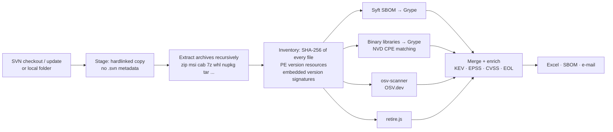

# vulnscan

`vulnscan` finds known vulnerabilities in the files we ship to customers. It checks out SVN repositories
(or scans any local folder), unpacks every installer and archive, identifies every third-party component —
including libraries compiled into first-party DLLs — and matches them against CVE, GitHub and OSV advisories,
the CISA **Known Exploited Vulnerabilities** catalog, EPSS exploit scores and end-of-life data. The result is
an Excel report, optionally a CycloneDX SBOM and an e-mail. Everything runs in one container, so it works the
same on Windows (Podman/Docker Desktop), Linux and CI.

It is built to **fail closed**: a run is only reported as complete when every repository was scanned by every
engine, the vulnerability data was current and each engine passed a self-test. Anything else is reported,
loudly, as incomplete — never as an all-clear.

<p align="center"></p>

- [Quick start](#quick-start)
- [What it reports](#what-it-reports)
- [How it works](#how-it-works)
- [Usage](#usage)
- [Scheduled scans and e-mail](#scheduled-scans-and-e-mail)
- [Configuration](#configuration)
- [Trust: fail-closed behaviour, exit codes, verification](#trust-fail-closed-behaviour-exit-codes-verification)
- [Development](#development)
- [Limitations](#limitations)

## Quick start

1. **Get the image.** Published by CI to GHCR, tagged with the commit SHA (see the repository's *Packages*):

   ```sh
   podman login ghcr.io            # only needed while the package is private
   podman pull ghcr.io/cadworkna/vulnscan:<tag>
   ```

   Or build it yourself: `podman build -t vulnscan .`

2. **Create a `.env`** in the folder you will run from (copy [`.env.example`](.env.example)):

   ```ini
   SVN_USERNAME=me
   SVN_PASSWORD=...
   VULNSCAN_REPOS=app_2026=https://svn.example.com/app/trunk,tools_2026=https://svn.example.com/tools/trunk
   ```

   Repository URLs and credentials are deliberately **not** part of the image.

3. **Scan.** The report is written to the folder you mount at `/work` (here: the current folder):

   ```sh
   podman run --rm -it --env-file .env -v vulnscan-cache:/cache -v "$PWD:/work" ghcr.io/cadworkna/vulnscan:<tag> --app_2026
   podman run --rm -it --env-file .env -v vulnscan-cache:/cache -v "$PWD:/work" ghcr.io/cadworkna/vulnscan:<tag> --all
   ```

   PowerShell: use `${PWD}` instead of `$PWD`. Docker works the same (`docker run ...`).

The named volume `vulnscan-cache` keeps the SVN checkouts and vulnerability databases between runs. The first
checkout of a large repository takes a while (progress, size and ETA are shown); later runs only `svn update`.

## What it reports

Every run writes `vulnscan_<repos>_<timestamp>.xlsx` to the mounted folder, plus an evidence folder
`vulnscan-results/<timestamp>_<repos>/` with the full log, the SBOMs and the raw output of every scanner — so any
finding can be traced back to the tool and database that produced it.

| Sheet | Contents |
|---|---|
| **Summary** | Totals, priority/KEV/severity tiles, per-repository breakdown and chart, highest-risk components, anything that needs attention, method and exact toolchain/database versions |
| **Findings** | One row per *(repository, file, vulnerability)*: priority, severity, CVSS, CISA KEV (date added, due date, ransomware use), EPSS, component, installed and fixed version, description, CWE, detection engine(s), confidence, evidence, references |
| **Vulnerabilities** | One row per distinct vulnerability and component, with the number of affected files |
| **Components** | Every identified third-party component, how it was identified, its exposure and end-of-life status |
| **End of Life** | Unsupported runtimes and libraries (endoflife.date; Microsoft Visual C++ runtimes) |
| **Binaries** | Every executable shipped: vendor, product, versions, signature, SHA-256, identified libraries. Third-party binaries that could not be matched to a known component are flagged **REVIEW** |
| **Coverage** | What was scanned (files, archives, binaries), engine status and duration per repository, archives that could not be extracted |

<p align="center"></p>
<p align="center"></p>

**Priority** combines severity with evidence of exploitation:

| | Rule |
|---|---|
| **P1** | On the CISA KEV list (exploited in the wild), or Critical with EPSS ≥ 10 % |
| **P2** | Critical, or High with EPSS ≥ 5 % |
| **P3** | High or Medium |
| **P4** | Low, negligible or unknown |

**Confidence** is *high* when a component was identified exactly (package metadata, version banner) and *medium*
for CPE/name-based matches, which can include false positives — e.g. for vendor builds that backport fixes. When
engines disagree, the higher severity wins: for a disclosure obligation, over-reporting with a confidence flag is
preferable to missing something.

With `--sbom`, each repository also gets a **CycloneDX 1.6** SBOM (`vulnscan_<repo>_<timestamp>.cdx.json`) with
every package and every library found inside binaries (CPE, identification evidence, file locations), the SHA-256
of each shipped executable, and a `vulnerabilities` section (VDR) linking each CVE to the affected component. It is
validated against the official schema and can be imported into Dependency-Track.

## How it works



| Engine | Finds | Data |
|---|---|---|
| **Syft → Grype** | Python, npm, .NET, Java, Go, Rust… packages, plus Syft's binary classifiers | Anchore vulnerability DB: NVD, GitHub advisories, vendor feeds, with CISA KEV and EPSS |
| **Binary identification → Grype** | Native libraries in DLL/EXE/PYD files — from the Windows version resource and from version strings embedded in the binary, which also catches libraries **statically linked into first-party DLLs** (OpenSSL, zlib, libpng, libjpeg-turbo, libtiff, curl, expat, SQLite, Python, Qt, FFmpeg, 7-Zip, bzip2, Chromium/CEF, Open Design Alliance, …) | NVD CPE data in the same DB |
| **osv-scanner** | Independent second opinion on packages, with its own extractors | OSV.dev, downloaded for offline matching (no package list leaves the machine) |
| **retire.js** | Vulnerable JavaScript libraries in standalone `.js` files | retire.js repository |
| **End of life** | Unsupported Python, OpenSSL, Qt, Node.js, … and Visual C++ 2005–2013 runtimes | endoflife.date, Microsoft lifecycle |

All scanner versions are pinned and checksum-verified in the [`Containerfile`](Containerfile); the versions
and database build dates used are recorded in every report.

## Usage

```
vulnscan [--all | --<repo> ... | --repo NAME ... | --path DIR ...] [options]
```

| Option | |
|---|---|
| `--all` | every configured repository |
| `--<repo>`, `--repo NAME` | one repository (repeatable); `--list` shows the configured ones |
| `--path DIR` | scan a local folder instead of SVN, e.g. a build output (relative to `/work`, or mount it) |
| `--sbom` | also write a CycloneDX SBOM per repository |
| `--email` | e-mail the summary and the report ([SMTP settings](#configuration)) |
| `--schedule CRON` | keep running and scan on a cron schedule, e.g. `"0 2 * * 1"` ([below](#scheduled-scans-and-e-mail)) |
| `--scheduled` | same, with the schedule from `VULNSCAN_SCHEDULE` (what the Compose service uses) |
| `--fail-on LEVEL` | exit 1 if findings at or above `critical`, `high`, `medium`, `low`, `kev`, `p1` or `p2` exist (CI gating) |
| `--no-update` | scan the cached checkout without `svn update` |
| `--offline` | no network: cached checkouts and databases only (the run is still flagged if data is stale) |
| `--engines` | subset of `packages,binaries,osv,retire` |
| `--no-extract`, `--no-hash` | skip archive extraction / hashing (faster, less complete) |
| `--jobs N` | parallel workers (default: CPU count) |
| `-v` | show every tool output line live (always in `scan.log`) |

Scan a build folder that is not in SVN:

```sh
podman run --rm -it -v vulnscan-cache:/cache -v "$PWD:/work" ghcr.io/cadworkna/vulnscan:<tag> --path dist --sbom
```

<p align="center"></p>

## Scheduled scans and e-mail

[`compose.yaml`](compose.yaml) runs vulnscan as a long-lived service (works as a **Dockhand** stack) that scans on a
cron schedule and e-mails the result:

```sh
docker compose up -d                          # scheduled: VULNSCAN_SCHEDULE / VULNSCAN_ARGS from .env
docker compose run --rm scan --tools_2026       # one-off run with the same configuration
```

The schedule is evaluated in the container's time zone (`TZ`). A run that crashes or cannot produce a report sends
a **"SCAN FAILED"** e-mail instead — a scheduled scan never fails silently.

<p align="center"></p>

## Configuration

All settings are environment variables (`--env-file .env` or the Compose `env_file`). Any secret can instead be
read from a file with the `_FILE` suffix, e.g. `SMTP_PASSWORD_FILE=/run/secrets/smtp_password`.

| Variable | |
|---|---|
| `SVN_USERNAME`, `SVN_PASSWORD` | SVN credentials (passed to svn on stdin, never cached or on a command line) |
| `SVN_TRUST_SERVER_CERT` | `1` to accept a certificate not signed by a public CA |
| `VULNSCAN_REPOS` | `name=url,name=url` (or a JSON object). Alternatively a `vulnscan-repos.json` in the mounted folder; SVN working copies in the mounted folder are also picked up |
| `SMTP_HOST`, `SMTP_PORT`, `SMTP_SECURITY` | mail server; `starttls` (default, port 587), `ssl` (465) or `none` |
| `SMTP_USERNAME`, `SMTP_PASSWORD` | optional SMTP login |
| `SMTP_FROM`, `SMTP_TO`, `SMTP_CC` | addresses (comma separated) |
| `SMTP_SUBJECT_PREFIX` | default `[vulnscan]` |
| `SMTP_MAX_ATTACHMENT_MB` | larger reports are not attached; the e-mail points to the output folder (default 15) |
| `VULNSCAN_SCHEDULE` | cron schedule used by `--scheduled` (ignored by normal runs) |
| `VULNSCAN_ACCEPTED_GAPS` | accepted coverage gaps as JSON, instead of `vulnscan-accepted-gaps.json` ([below](#accepted-coverage-gaps)) |
| `TZ` | time zone for schedules and timestamps, e.g. `America/Toronto` |
| `VULNSCAN_TAG`, `VULNSCAN_REPORTS`, `VULNSCAN_ARGS` | Compose only: image tag, report folder on the host, arguments of the scheduled service |

Disk: the cache volume holds the checkouts (the size of the repositories) plus about 2 GB of vulnerability data.

## Trust: fail-closed behaviour, exit codes, verification

Many scanners report "0 vulnerabilities" when they actually scanned nothing. vulnscan treats all of these as an
**incomplete** scan — shown in red in the terminal, the report and the e-mail subject, with exit code 3:

- a repository could not be checked out/updated, or contained no files;
- a scanner failed, exited with an error, or produced missing, truncated or malformed output;
- the vulnerability database could not be updated or is older than 3 days, or its KEV/EPSS data is missing;
- an engine failed its **self-test**: before every scan each engine must detect a known-vulnerable canary
  (OpenSSL 1.1.1k → CVE-2021-3711, requests 2.19.1 → CVE-2018-18074, jQuery 1.12.4 → CVE-2020-11023);
- end-of-life data could not be retrieved;
- an archive could not be extracted, or only partly (e.g. password-protected members) — its contents were not
  scanned — unless it is an [accepted coverage gap](#accepted-coverage-gaps).

| Exit code | Meaning |
|---|---|
| 0 | complete — every check passed |
| 1 | complete, but findings reached the `--fail-on` threshold |
| 2 | invalid arguments or configuration |
| 3 | **incomplete or failed** — not an all-clear |
| 4 | complete, but the e-mail could not be sent |

**Verifying the image.** Once the repository is public, images published by CI carry Sigstore-signed build provenance and an SBOM attestation (GitHub only offers these for public repositories on our plan):

```sh
gh attestation verify oci://ghcr.io/cadworkna/vulnscan:<tag> --owner CadworkNA
```

CI also scans the image itself and fails on any actively exploited (KEV) vulnerability, unless it is listed with a
justification and an expiry date in [`.github/selfscan-exceptions.json`](.github/selfscan-exceptions.json).

**Untrusted content is never processed as root.** The container starts as root only to take ownership of the cache,
then permanently switches to the owner of the mounted `/work` folder (so reports belong to you on Linux hosts) or to
the unprivileged `vulnscan` user (uid 10001). Archive extraction is confined to the scan folder; symbolic links in a
repository are recorded on the Coverage sheet but never followed.

### Accepted coverage gaps

Some shipped archives cannot be fully scanned by design (e.g. a password-protected archive). Rather than letting
every run report *incomplete*, acknowledge each one explicitly in `vulnscan-accepted-gaps.json` in the mounted
folder. Each entry needs a reason; an expired entry stops matching, so the run becomes incomplete again until someone
re-evaluates it. Accepted gaps are still listed on the report's Coverage sheet.

```json
[
  {"repo": "app_2026", "path": "bin/*/templates.zip", "reason": "password-protected vendor archive", "expires": "2027-11-01"}
]
```

`repo` may be `*`; `path` is a glob on the path shown in the report.

## Development

```text
vulnscan/
  cli.py       arguments, orchestration, console summary, scheduler loop
  svn.py       repository configuration, cached checkout/update
  stage.py     staging, archive extraction, inventory
  pe.py        PE version resources -> components (identification rules)
  binsig.py    embedded version signatures (statically linked libraries)
  scanners.py  engine runners, strict output parsing, self-test, database health
  enrich.py    merge, KEV/EPSS/CVSS enrichment, priority, end of life
  report.py    Excel report        sbom.py   CycloneDX SBOM
  notify.py    e-mail              schedule.py  cron
tests/         unit, contract (recorded scanner output) and detection tests
```

Tests run inside the image, against the working tree:

```sh
podman build -t vulnscan .
podman run --rm -v "$PWD:/src:ro" -e PYTHONPATH=/src --entrypoint sh vulnscan -c \
  'uv pip install -q --python /opt/venv/bin/python pytest pytest-cov openpyxl "cyclonedx-python-lib[json-validation]" \
   && cd /src && python -m pytest --cov=vulnscan'
# full pipeline on public known-vulnerable artifacts (network, ~1 min):
#   ... python -m pytest -m integration
```

- **Unit tests** cover identification rules, signatures, merging, priority, end-of-life, cron, configuration, the
  report, the e-mail and the SBOM (validated against the CycloneDX schema).
- **Contract tests** parse recorded real output of Grype, osv-scanner and retire.js ([`tests/fixtures`](tests/fixtures)),
  so a format change in a scanner upgrade fails CI instead of silently dropping findings.
- **The detection test** downloads public, known-vulnerable artifacts (hash-verified), runs the full pipeline and
  asserts that specific CVEs, KEV flags and end-of-life findings are still detected. CI runs it on every change and
  weekly, together with the self-scan.

**Updating a scanner:** change its version and SHA-256 in the `Containerfile` (from the release's checksum file),
run the tests, and refresh the fixtures if the output format changed. **Adding an identification rule:** extend
`pe.py` (version resources) or `binsig.py` (embedded strings, NVD vendor/product names) and add a test case.

**README images** are generated from a demo scan of public artifacts — never from real scan data.

## Limitations

- Detection is only as good as the identification. A third-party binary without version information or a known
  signature cannot be matched; those are listed as **REVIEW** on the Binaries sheet for a human to check.
- CPE matching (medium confidence) can report vulnerabilities that a vendor build has already patched.
- Self-extracting installers (`.exe`) are scanned as binaries but not unpacked; archives that need a password are
  reported as coverage gaps.
- vulnscan finds *known* vulnerabilities. It does not detect malware, check licences, or find new vulnerabilities in
  our own code.

## License

[MIT](LICENSE)
