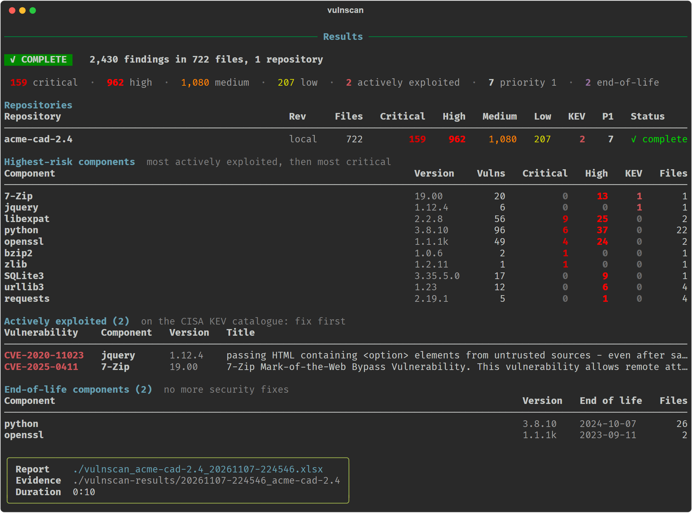
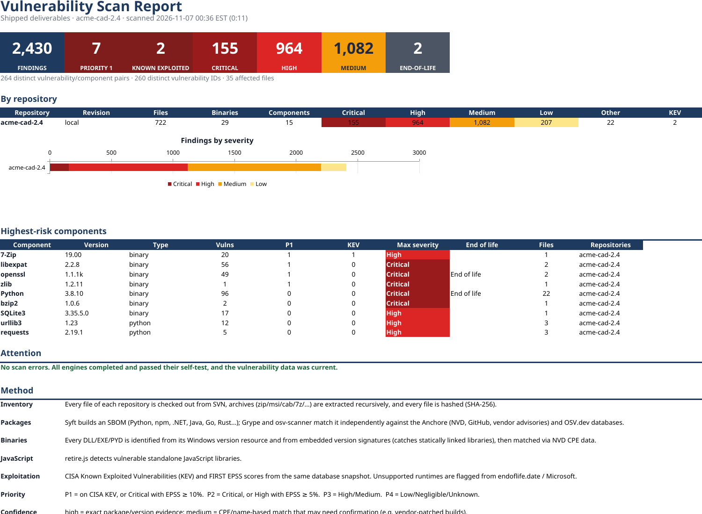
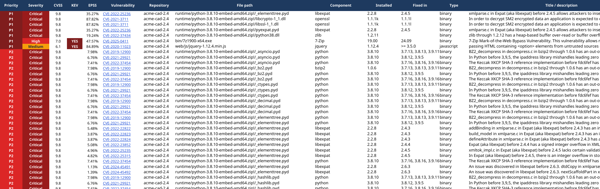
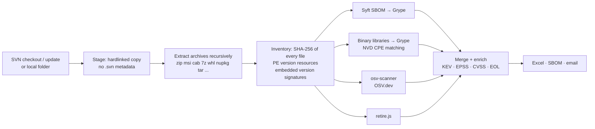
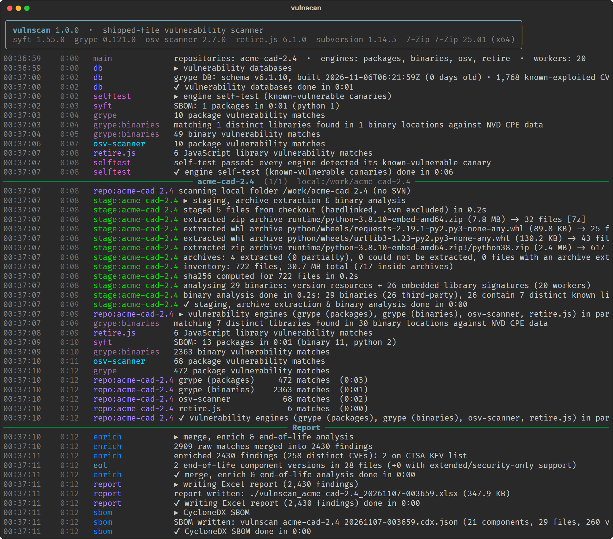
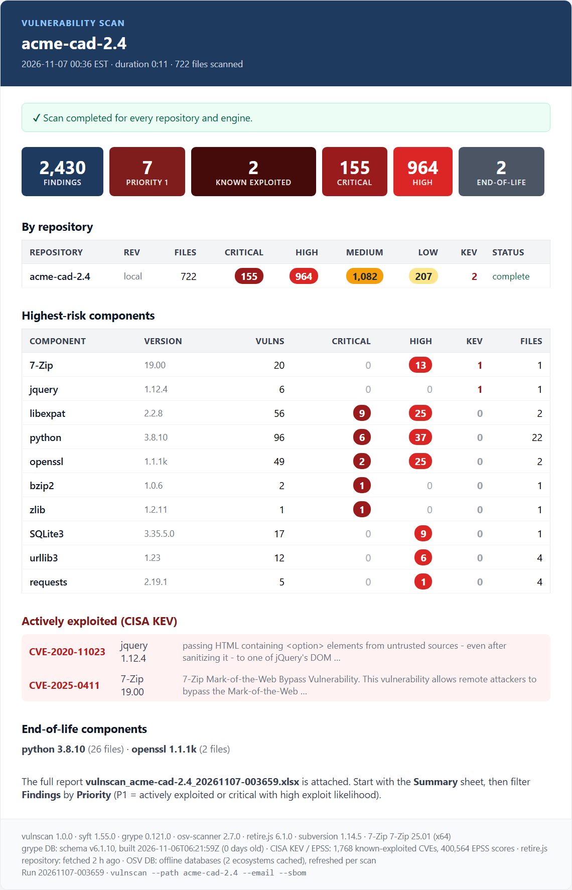

# vulnscan

[](https://github.com/CadworkNA/vulnscan/actions/workflows/build.yml)
[](https://github.com/CadworkNA/vulnscan/releases/latest)
[](LICENSE)<br>
[](https://scorecard.dev/viewer/?uri=github.com/CadworkNA/vulnscan)
[](https://www.bestpractices.dev/projects/16419)
[](#trust-fail-closed-behaviour-exit-codes-verification)
[](https://github.com/CadworkNA/vulnscan/pkgs/container/vulnscan)

`vulnscan` finds known vulnerabilities in the files we ship to customers. It checks out SVN repositories
(or scans any local folder), unpacks every installer and archive, identifies every third-party component
(including libraries compiled into first-party DLLs) and matches them against CVE, GitHub and OSV advisories,
the CISA **Known Exploited Vulnerabilities** catalog, EPSS exploit scores and end-of-life data. For every
vulnerable component it works out the lowest version that fixes all of its vulnerabilities and, optionally,
**what that upgrade breaks** (AI-assisted, from the release notes and the functions our binaries actually call).
The result is an Excel report, optionally a CycloneDX SBOM and an email. Everything runs in one container, so it
works the same on Windows (Podman/Docker Desktop), Linux and CI.

It is built to **fail closed**: a run is only reported as complete when every repository was scanned by every
engine, the vulnerability data was current and each engine passed a self-test. Anything else is reported,
loudly, as incomplete, never as an all-clear.

<p align="center"></p>

- [Quick start](#quick-start)
- [What it reports](#what-it-reports)
- [How it works](#how-it-works)
- [Usage](#usage)
- [Upgrade advice (AI, optional)](#upgrade-advice-ai-optional)
- [Scheduled scans and email](#scheduled-scans-and-email)
- [Configuration](#configuration)
- [Trust: fail-closed behaviour, exit codes, verification](#trust-fail-closed-behaviour-exit-codes-verification)
- [Versions and releases](#versions-and-releases)
- [Development](#development)
- [Limitations](#limitations)

## Quick start

1. **Get the image.** Published to GHCR for every [release](https://github.com/CadworkNA/vulnscan/releases)
   (see [Versions and releases](#versions-and-releases) for the available tags):

   ```sh
   docker pull ghcr.io/cadworkna/vulnscan:1
   ```

   Or build it yourself: `docker build -t vulnscan .`

2. **Create a `.env`** in the folder you will run from (copy [`.env.example`](.env.example)):

   ```ini
   SVN_USERNAME=me
   SVN_PASSWORD=...
   VULNSCAN_REPOS=app_2026=https://svn.example.com/app/trunk,tools_2026=https://svn.example.com/tools/trunk
   ```

   Repository URLs and credentials are deliberately **not** part of the image.

3. **Scan.** The report is written to the folder you mount at `/work` (here: the current folder):

   ```sh
   docker run --rm -it --env-file .env -v vulnscan-cache:/cache -v "$PWD:/work" ghcr.io/cadworkna/vulnscan:1 --app_2026
   docker run --rm -it --env-file .env -v vulnscan-cache:/cache -v "$PWD:/work" ghcr.io/cadworkna/vulnscan:1 --all
   ```

   PowerShell: use `${PWD}` instead of `$PWD`. Podman works the same (`podman run ...`).

The named volume `vulnscan-cache` keeps the SVN checkouts and vulnerability databases between runs. The first
checkout of a large repository takes a while (progress, size and ETA are shown); later runs only `svn update`.

## What it reports

Every run writes `vulnscan_<repos>_<timestamp>.xlsx` to the mounted folder, plus an evidence folder
`vulnscan-results/<timestamp>_<repos>/` with the full log, the SBOMs and the raw output of every scanner, so any
finding can be traced back to the tool and database that produced it.

| Sheet | Contents |
|---|---|
| **Summary** | Totals, priority/KEV/severity tiles, per-repository breakdown and chart, highest-risk components, anything that needs attention, method and exact toolchain/database versions |
| **Findings** | One row per *(repository, file, vulnerability)*: priority, severity, CVSS, CISA KEV (date added, due date, ransomware use), EPSS, component, installed and fixed version, description, CWE, detection engine(s), confidence, evidence, references |
| **Vulnerabilities** | One row per distinct vulnerability and component, with the number of affected files |
| **Upgrades** | One row per vulnerable component: the lowest version that fixes **all** of its vulnerabilities (staying on the installed release line when a fix exists there), the size of the step (patch/minor/major), vulnerabilities without a fix, matches where the installed version is already at or above every reported fix (*verify the match*), and whether the target is itself end of life (with a supported alternative). With `--ai`, also the [upgrade advice](#upgrade-advice-ai-optional) |
| **Upgrade changes** | With `--ai`: every documented change between the installed and the target version, with its quote from the release notes and the source |
| **Components** | Every identified third-party component, how it was identified, its exposure and end-of-life status |
| **End of Life** | Unsupported runtimes and libraries (endoflife.date; Microsoft Visual C++ runtimes) |
| **Binaries** | Every executable shipped: vendor, product, versions, signature, SHA-256, identified libraries. Third-party binaries that could not be matched to a known component are flagged **REVIEW** |
| **Coverage** | What was scanned (files, archives, binaries), engine status and duration per repository, archives that could not be extracted |

<p align="center"></p>
<p align="center"></p>

**Priority** combines severity with evidence of exploitation:

| | Rule |
|---|---|
| **P1** | On the CISA KEV list (exploited in the wild), or Critical with EPSS ≥ 10 % |
| **P2** | Critical, or High with EPSS ≥ 5 % |
| **P3** | High or Medium |
| **P4** | Low, negligible or unknown |

**Confidence** is *high* when a component was identified exactly (package metadata, version banner) and *medium*
for CPE/name-based matches, which can include false positives (e.g. for vendor builds that backport fixes). When
engines disagree, the higher severity wins: for a disclosure obligation, over-reporting with a confidence flag is
preferable to missing something.

With `--sbom`, each repository also gets a **CycloneDX 1.6** SBOM (`vulnscan_<repo>_<timestamp>.cdx.json`) with
every package and every library found inside binaries (CPE, identification evidence, file locations), the SHA-256
of each shipped executable, and a `vulnerabilities` section (VDR) linking each CVE to the affected component. It is
validated against the official schema and can be imported into Dependency-Track.

## How it works



| Engine | Finds | Data |
|---|---|---|
| **Syft → Grype** | Python, npm, .NET, Java, Go, Rust… packages, plus Syft's binary classifiers | Anchore vulnerability DB: NVD, GitHub advisories, vendor feeds, with CISA KEV and EPSS |
| **Binary identification → Grype** | Native libraries in DLL/EXE/PYD files, identified from the Windows version resource and from version strings embedded in the binary, which also catches libraries **statically linked into first-party DLLs** (OpenSSL, zlib, libpng, libjpeg-turbo, libtiff, curl, expat, SQLite, Python, Qt, FFmpeg, 7-Zip, bzip2, Chromium/CEF, Open Design Alliance, …) | NVD CPE data in the same DB |
| **osv-scanner** | Independent second opinion on packages, with its own extractors | OSV.dev, downloaded for offline matching (no package list leaves the machine) |
| **retire.js** | Vulnerable JavaScript libraries in standalone `.js` files | retire.js repository |
| **End of life** | Unsupported Python, OpenSSL, Qt, Node.js, … and Visual C++ 2005–2013 runtimes | endoflife.date, Microsoft lifecycle |

All scanner versions are pinned and checksum-verified in the [`Containerfile`](Containerfile); the versions
and database build dates used are recorded in every report.

## Usage

```
vulnscan [--all | --<repo> ... | --repo NAME ... | --path DIR ...] [options]
```

| Option | |
|---|---|
| `--all` | every configured repository |
| `--<repo>`, `--repo NAME` | one repository (repeatable); `--list` shows the configured ones |
| `--path DIR` | scan a local folder instead of SVN, e.g. a build output (relative to `/work`, or mount it) |
| `--sbom` | also write a CycloneDX SBOM per repository |
| `--email` | email the summary and the report ([SMTP settings](#configuration)) |
| `--ai` | [upgrade advice](#upgrade-advice-ai-optional): what changes between the installed and the fixed version (needs `VULNSCAN_AI_MODEL`; sends public component names and versions out, see there) |
| `--schedule CRON` | keep running and scan on a cron schedule, e.g. `"0 2 * * 1"` ([below](#scheduled-scans-and-email)) |
| `--scheduled` | same, with the schedule from `VULNSCAN_SCHEDULE` (what the Compose service uses) |
| `--fail-on LEVEL` | exit 1 if findings at or above `critical`, `high`, `medium`, `low`, `kev`, `p1` or `p2` exist (CI gating) |
| `--no-update` | scan the cached checkout without `svn update` |
| `--offline` | no network: cached checkouts and databases only (the run is still flagged if data is stale) |
| `--engines` | subset of `packages,binaries,osv,retire` |
| `--no-extract`, `--no-hash` | skip archive extraction / hashing (faster, less complete) |
| `--jobs N` | parallel workers (default: CPU count) |
| `-v` | show every tool output line live (always in `scan.log`) |

Scan a build folder that is not in SVN:

```sh
docker run --rm -it -v vulnscan-cache:/cache -v "$PWD:/work" ghcr.io/cadworkna/vulnscan:1 --path dist --sbom
```

<p align="center"></p>

## Upgrade advice (AI, optional)

Knowing that OpenSSL 1.1.1k must become 3.0.12 is half the answer; the other half is what that upgrade breaks.
With `--ai`, vulnscan collects the evidence for every upgrade on the **Upgrades** sheet and has a language model
read it:

| Evidence | From | Decided by |
|---|---|---|
| **Release notes**, changelogs and migration guides between the installed and the target version | Package registries (PyPI, npm, NuGet, Maven Central, crates.io, Go proxy, RubyGems), GitHub/GitLab, and curated sources for native libraries (OpenSSL, curl, zlib, Qt, Python, Node.js, SQLite, …) | The model extracts each change, **quoting** the notes; a change whose quote is not found word for word in the notes is dropped |
| **Runtime requirements** of both versions: Python (and prebuilt Windows wheels), Node.js, .NET target frameworks, Rust, Go, Ruby | Registry metadata, checked against the runtimes shipped in the same repository | vulnscan |
| **Our use** of the component: the functions our binaries import from its DLLs | PE import tables of the scanned files | vulnscan, locally |

Each upgrade then gets:

- **Breaking changes**: *likely* (a documented incompatible/removed/ABI change, or a requirement our shipped
  runtime does not meet), *possible* (other API or behaviour changes, or a major step), *unlikely* (the notes cover
  the whole range and document nothing incompatible) or *unknown* (no or incomplete notes). The verdict is computed
  from the verified changes, never chosen by the model, and missing evidence never reads as *unlikely*.
- **Affects our binaries**: *yes: SSL_CTX_new, …* when a documented change names a function our binaries import
  from that DLL. Statically linked copies have no imports, so they show no answer here.
- A short summary and migration steps (AI-generated), the requirement changes and the sources used.

The advice is **advisory**: it never changes whether a run is complete or the exit code, and a failure (provider
down, no release notes, rate limit) shows as *not analysed* or *unknown*, never as safe.

**What leaves the machine** (only with `--ai`): the names and versions of third-party components that matched a
public advisory, sent to the package registries, GitHub/GitLab and the model provider, and the public release notes
sent to the model provider. Never a repository name, path or file name, and not which functions our binaries
call (that comparison runs locally). Requests only go to an allowlist of hosts, also across redirects.

**Configuration.** The model is any [Pydantic AI](https://ai.pydantic.dev/models/) model string; the image
includes the Anthropic provider:

```ini
VULNSCAN_AI_MODEL=anthropic:claude-sonnet-5-5
ANTHROPIC_API_KEY=...            # or ANTHROPIC_API_KEY_FILE=/run/secrets/anthropic
GITHUB_TOKEN=...                 # optional, no scopes needed: 5,000 GitHub requests an hour instead of 60
```

Release notes and model answers are cached in the cache volume (`/cache/db/advisor`), so repeated scans cost
almost nothing and `--offline` reuses them. `VULNSCAN_AI_MAX_UPGRADES` (default 100, highest priority first)
bounds the cost of one run; the model, the number of requests and tokens are recorded on the Summary sheet.

## Scheduled scans and email

[`compose.yaml`](compose.yaml) runs vulnscan as a long-lived service (works as a **Dockhand** stack) that scans on a
cron schedule and emails the result:

```sh
docker compose up -d                          # scheduled: VULNSCAN_SCHEDULE / VULNSCAN_ARGS from .env
docker compose run --rm scan --tools_2026       # one-off run with the same configuration
```

The schedule is evaluated in the container's time zone (`TZ`). A run that crashes or cannot produce a report sends
a **"SCAN FAILED"** email instead: a scheduled scan never fails silently.

<p align="center"></p>

## Configuration

All settings are environment variables (`--env-file .env` or the Compose `env_file`). Any secret can instead be
read from a file with the `_FILE` suffix, e.g. `SMTP_PASSWORD_FILE=/run/secrets/smtp_password`.

| Variable | |
|---|---|
| `SVN_USERNAME`, `SVN_PASSWORD` | SVN credentials (passed to svn on stdin, never cached or on a command line) |
| `SVN_TRUST_SERVER_CERT` | `1` to accept a certificate not signed by a public CA |
| `VULNSCAN_REPOS` | `name=url,name=url` (or a JSON object). Alternatively a `vulnscan-repos.json` in the mounted folder; SVN working copies in the mounted folder are also picked up |
| `SMTP_HOST`, `SMTP_PORT`, `SMTP_SECURITY` | mail server; `starttls` (default, port 587), `ssl` (465) or `none` |
| `SMTP_USERNAME`, `SMTP_PASSWORD` | optional SMTP login |
| `SMTP_FROM`, `SMTP_TO`, `SMTP_CC` | addresses (comma separated) |
| `SMTP_SUBJECT_PREFIX` | default `[vulnscan]` |
| `SMTP_MAX_ATTACHMENT_MB` | larger reports are not attached; the email points to the output folder (default 15) |
| `VULNSCAN_SCHEDULE` | cron schedule used by `--scheduled` (ignored by normal runs) |
| `VULNSCAN_ACCEPTED_GAPS` | accepted coverage gaps as JSON, instead of `vulnscan-accepted-gaps.json` ([below](#accepted-coverage-gaps)) |
| `VULNSCAN_UPDATE_CHECK` | `0` to skip the start-up check for a newer vulnscan release (one GitHub request a day, skipped with `--offline`; it only warns, never changes the result) |
| `VULNSCAN_AI_MODEL` | `--ai` only: Pydantic AI model string, e.g. `anthropic:claude-sonnet-5-5`, plus the provider's key (`ANTHROPIC_API_KEY`) |
| `GITHUB_TOKEN` | `--ai` only, optional: GitHub token for release notes (higher rate limit; sent to `api.github.com` only) |
| `VULNSCAN_AI_MAX_UPGRADES`, `VULNSCAN_AI_CONCURRENCY` | `--ai` only: upgrades analysed per run (default 100) and parallel model requests (default 4) |
| `TZ` | time zone for schedules and timestamps, e.g. `America/Toronto` |
| `VULNSCAN_TAG`, `VULNSCAN_REPORTS`, `VULNSCAN_ARGS` | Compose only: image tag, report folder on the host, arguments of the scheduled service |

Disk: the cache volume holds the checkouts (the size of the repositories) plus about 2 GB of vulnerability data.

## Trust: fail-closed behaviour, exit codes, verification

Many scanners report "0 vulnerabilities" when they actually scanned nothing. vulnscan treats all of these as an
**incomplete** scan, shown in red in the terminal, the report and the email subject, with exit code 3:

- a repository could not be checked out/updated, or contained no files;
- a scanner failed, exited with an error, or produced missing, truncated or malformed output;
- the vulnerability database could not be updated or is older than 3 days, or its KEV/EPSS data is missing;
- an engine failed its **self-test**: before every scan each engine must detect a known-vulnerable canary
  (OpenSSL 1.1.1k → CVE-2021-3711, requests 2.19.1 → CVE-2018-18074, jQuery 1.12.4 → CVE-2020-11023);
- end-of-life data could not be retrieved;
- an archive could not be extracted, or only partly (e.g. password-protected members), so its contents were not
  scanned, unless it is an [accepted coverage gap](#accepted-coverage-gaps).

| Exit code | Meaning |
|---|---|
| 0 | complete: every check passed |
| 1 | complete, but findings reached the `--fail-on` threshold |
| 2 | invalid arguments or configuration |
| 3 | **incomplete or failed**, not an all-clear |
| 4 | complete, but the email could not be sent |

The [upgrade advice](#upgrade-advice-ai-optional) never affects completeness or the exit code: it is advisory,
and what it could not analyse is reported as such.

**Verifying the image.** Images published by CI carry Sigstore-signed build provenance and an SBOM attestation; each
[release](https://github.com/CadworkNA/vulnscan/releases) lists its image digest and the image SBOM:

```sh
gh attestation verify oci://ghcr.io/cadworkna/vulnscan:1.1.1 --owner CadworkNA
```

Each release also signs the files it attaches (image SBOM, self-scan): the `vulnscan-<version>.sigstore.json`
bundle next to them lets you verify a download without looking the attestation up on GitHub:

```sh
gh attestation verify vulnscan.cdx.json --owner CadworkNA --bundle vulnscan-<version>.sigstore.json
```

CI also scans the image itself and fails on any actively exploited (KEV) vulnerability, unless it is listed with a
justification and an expiry date in [`.github/selfscan-exceptions.json`](.github/selfscan-exceptions.json).

**Untrusted content is never processed as root.** The container starts as root only to take ownership of the cache,
then permanently switches to the owner of the mounted `/work` folder (so reports belong to you on Linux hosts) or to
the unprivileged `vulnscan` user (uid 10001). Archive extraction is confined to the scan folder; symbolic links in a
repository are recorded on the Coverage sheet but never followed.

### Accepted coverage gaps

Some shipped archives cannot be fully scanned by design (e.g. a password-protected archive). Rather than letting
every run report *incomplete*, acknowledge each one explicitly in `vulnscan-accepted-gaps.json` in the mounted
folder. Each entry needs a reason; an expired entry stops matching, so the run becomes incomplete again until someone
re-evaluates it. Accepted gaps are still listed on the report's Coverage sheet.

```json
[
  {"repo": "app_2026", "path": "bin/*/templates.zip", "reason": "password-protected vendor archive", "expires": "2027-11-01"}
]
```

`repo` may be `*`; `path` is a glob on the path shown in the report.

## Versions and releases

vulnscan follows [semantic versioning](https://semver.org). Every release is a
[GitHub release](https://github.com/CadworkNA/vulnscan/releases) with notes, the image digest, the image SBOM and
the self-scan of the image, and is published to GHCR with these tags:

| Tag | Points to |
|---|---|
| `:1.2.3` | exactly that release; never moved (fixes ship as a new patch release) |
| `:1.2` | the latest `1.2.x` |
| `:1` | the latest `1.x.y`: new engines and fixes, no breaking changes |
| `:latest` | the latest release |
| `:<commit SHA>` | a build of `main`, unreleased; for testing only |

Which one to use: `:1` to receive improvements and security updates automatically; an exact version (or a digest,
`@sha256:…`) where a report must be traceable to an exact toolchain, e.g. the `VULNSCAN_TAG` of a scheduled stack.

What changes the version, for the command line, the configuration (`.env`), the exit codes and the outputs (Excel
report, SBOM, email):

- **major**: a breaking change: an option or variable removed or renamed, an exit code that changes meaning, a
  report sheet or column removed or restructured;
- **minor**: new options, engines, report content or identification rules, and scanner upgrades (Grype, Syft,
  osv-scanner, retire.js). These can change the findings for the same files, so compare reports across a minor
  release with that in mind;
- **patch**: bug fixes and security updates of the image (base image, Python packages) without a change in behaviour.

**Releasing** (maintainers): set the new version in `pyproject.toml` and `vulnscan/__init__.py` (a unit test keeps
them equal), merge to `main`, then tag that commit:

```sh
git tag v1.2.3 && git push origin v1.2.3       # prerelease: v1.2.3-rc.1 (gets only its exact tag)
```

CI refuses a tag that is not a semantic version or does not match `vulnscan --version`, runs the full test suite,
publishes and attests the image, and creates the GitHub release. A release of an older line (e.g. `1.0.5` after
`1.1.0`) moves only `:1.0`, never `:1` or `:latest`.

## Development

```text
vulnscan/
  cli.py       arguments, orchestration, console summary, scheduler loop
  svn.py       repository configuration, cached checkout/update
  stage.py     staging, archive extraction, inventory
  pe.py        PE version resources -> components (identification rules)
  binsig.py    embedded version signatures (statically linked libraries)
  scanners.py  engine runners, strict output parsing, self-test, database health
  enrich.py    merge, KEV/EPSS/CVSS enrichment, priority, end of life
  upgrade.py   upgrade paths: lowest version fixing every vulnerability, step size
  evidence.py  --ai: release notes, requirements, our imports (allowlisted, cached fetching)
  advisor.py   --ai: Pydantic AI extraction with quote verification, computed verdict
  report.py    Excel report        sbom.py   CycloneDX SBOM
  notify.py    email               schedule.py  cron
tests/         unit, contract (recorded scanner output) and detection tests
fuzz/          fuzz targets for hostile input (binary analysis, extraction paths)
```

Tests run inside the image, against the working tree:

```sh
docker build -t vulnscan .
docker run --rm -v "$PWD:/src:ro" -e PYTHONPATH=/src --entrypoint sh vulnscan -c \
  'uv pip install -q --python /opt/venv/bin/python pytest pytest-cov openpyxl "cyclonedx-python-lib[json-validation]" \
   && cd /src && python -m pytest --cov=vulnscan'
# full pipeline on public known-vulnerable artifacts (network, ~1 min):
#   ... python -m pytest -m integration
```

- **Unit tests** cover identification rules, signatures, merging, priority, end-of-life, cron, configuration, the
  report, the email and the SBOM (validated against the CycloneDX schema).
- **Contract tests** parse recorded real output of Grype, osv-scanner and retire.js ([`tests/fixtures`](tests/fixtures)),
  so a format change in a scanner upgrade fails CI instead of silently dropping findings.
- **The detection test** downloads public, known-vulnerable artifacts (hash-verified), runs the full pipeline and
  asserts that specific CVEs, KEV flags and end-of-life findings are still detected. CI runs it on every change and
  weekly, together with the self-scan.
- **Fuzz targets** ([`fuzz/`](fuzz), Atheris/libFuzzer) feed hostile input to the code that handles it: the binary
  analysis (PE version resources, identification rules, embedded signatures) must never crash or hang, and extraction
  folders must stay inside the stage whatever names an archive carries. CI fuzzes each target for a minute on every
  change and ten minutes weekly. Locally:

  ```sh
  docker run --rm -v "$PWD:/src:ro" -e PYTHONPATH=/src --entrypoint sh vulnscan -c \
    'uv pip install -q --python /opt/venv/bin/python atheris==3.1.0 && cd /tmp && FUZZ_SECONDS=60 sh /src/fuzz/run.sh'
  ```

**Updating a scanner:** change its version and SHA-256 in the `Containerfile` (from the release's checksum file),
run the tests, and refresh the fixtures if the output format changed. **Adding an identification rule:** extend
`pe.py` (version resources) or `binsig.py` (embedded strings, NVD vendor/product names) and add a test case. **Adding a release-note source**
for a native library: an entry in `evidence.NATIVE` (keyed by the NVD product name), checked against the real
changelog, and a test case. Tests never call a model or the network: they use Pydantic AI's `FunctionModel` and
a fake web.

**README images** are generated from a demo scan of public artifacts, never from real scan data.

**Contributing:** see [CONTRIBUTING.md](CONTRIBUTING.md) for the requirements a pull request must meet and the test
policy.

## Limitations

- Detection is only as good as the identification. A third-party binary without version information or a known
  signature cannot be matched; those are listed as **REVIEW** on the Binaries sheet for a human to check.
- CPE matching (medium confidence) can report vulnerabilities that a vendor build has already patched.
- Self-extracting installers (`.exe`) are scanned as binaries but not unpacked; archives that need a password are
  reported as coverage gaps.
- vulnscan finds *known* vulnerabilities. It does not detect malware, check licences, or find new vulnerabilities in
  our own code.

## License

[MIT](LICENSE)
